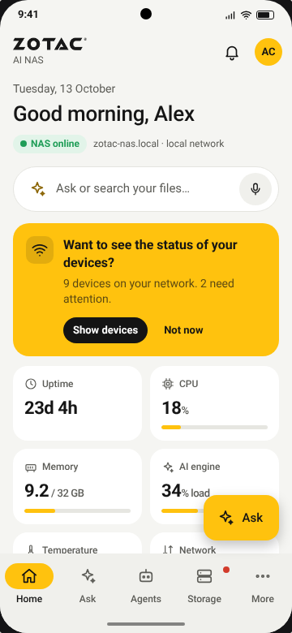
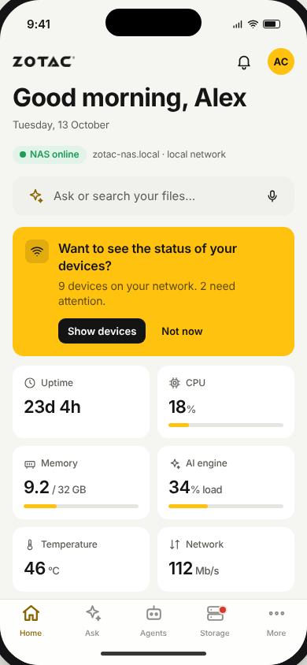
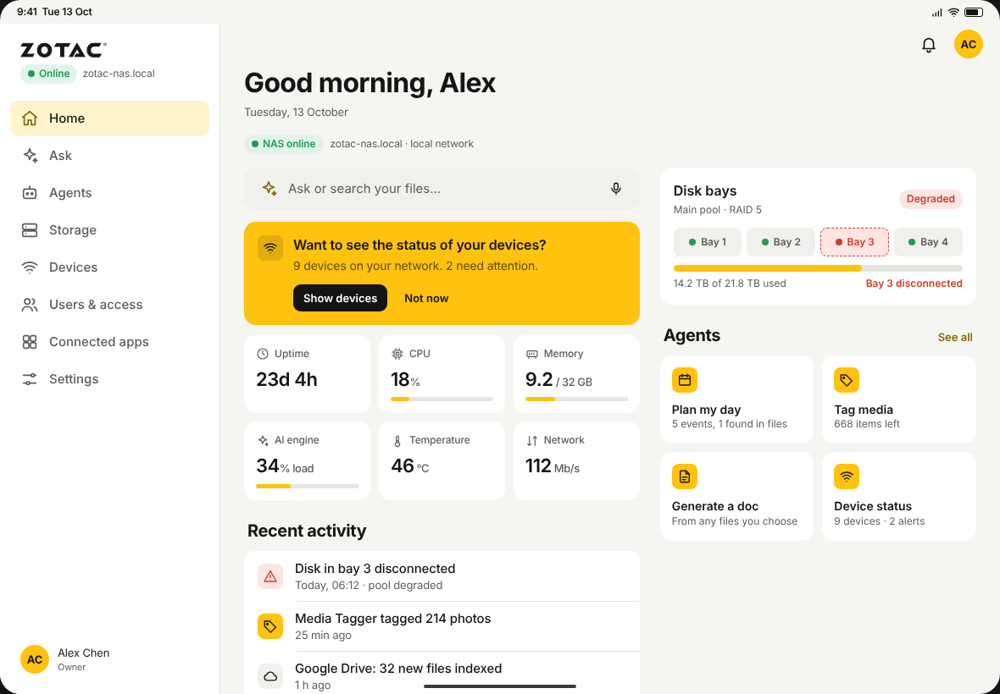

# sandobokksu

## ZOTAC AI NAS: companion app mockup

This is a clickable mockup of a mobile and tablet app for a home AI NAS with built-in generative AI tools. It shows the same app three ways:

- **Android phone**: Material 3-style top app bar, pill navigation bar, an "Ask" FAB and a snackbar for notifications
- **iPhone (iOS)**: large titles, tab bar, back-chevron navigation and banner notifications
- **Tablet**: sidebar layout with multi-column dashboards, switchable between iPadOS and Android tablet styling

All three run in a single page and support light and dark themes.

| Android | iOS | Tablet |
|---|---|---|
|  |  |  |

### Running it

Open `index.html` in a browser. It needs no build step and no dependencies; fonts load from Google Fonts. The controls at the top switch which device is shown, the tablet's platform, and the theme.

### Features in the mockup

| Area | What you can do |
|---|---|
| **Home** | NAS online status, uptime, CPU, memory, AI-engine load, temperature and network. Shows a disk-bay summary with the disconnected disk highlighted. Asks "Want to see the status of your devices?" and links to agent shortcuts and recent activity. |
| **Ask** | Chat with the NAS assistant or switch to semantic search. Source chips limit results to **My NAS**, **Google Drive** or **Web**. Results only include files you can access; restricted matches are counted as "hidden by permissions". |
| **Agents** | **Day Planner** (calendar plus dates found in your files), **Media Tagger** (accept suggested tags), **Doc Generator** (pick files and a format, then generate a document saved to the NAS) and **Device Monitor**. Also has automation toggles. |
| **Storage** | 4-bay chassis view with a disconnected bay 3. Tap a bay for disk details. "Blink bay LED" locates the bay; "Disk is back in" starts a pool rebuild. Also shows the RAID pool, 30-day uptime, shared folders and NVMe cache. |
| **Users & access** | List of people with their roles. Per-person controls cover role, storage quota, folder access (none / read / read & write) and AI permissions (Ask, Drive, Web, agents). |
| **Connected apps** | Google Drive, Calendar, Photos and Gmail, plus web search, a Matter / Thread smart-home hub, OneDrive and Dropbox. You can connect or disconnect each one. |
| **Devices** | Smart-home and network devices grouped by room, with on/off controls and alerts. |
| **Settings** | Theme, NAS connection and remote access, local AI model, re-indexing and notifications. |

Try these in **Ask**: "plan my day", "find beach photos from last summer", "summarise my insurance policy", "how are my devices?", "is my storage healthy?".

### Notes

- All data is sample data and the assistant's replies are scripted. Nothing connects to a real NAS, Google account or the web.
- The brand accent (`--accent` in `styles.css`) is an **approximation** of ZOTAC yellow. Replace it with the official hex value if you have one.
- Google, Microsoft and Dropbox services are shown with plain letter tiles, not their official logos.

### Files

- `index.html`: page shell and device frames
- `styles.css`: design tokens (light/dark), device frames and component styles
- `app.js`: sample data, views, platform-specific chrome and interactions
- `assets/zotac-logo.png`: the supplied logo, cropped onto a transparent background
